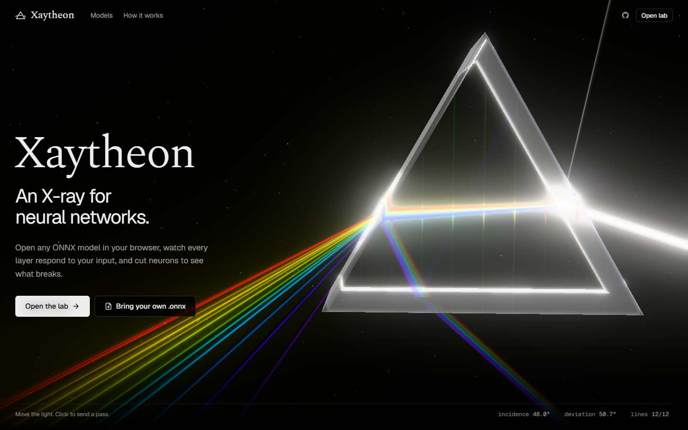
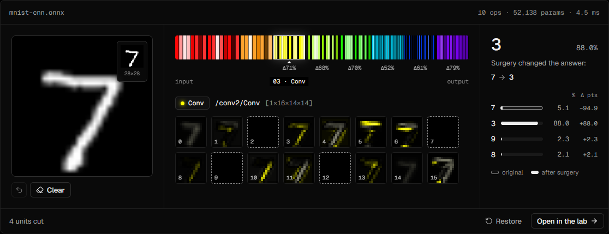
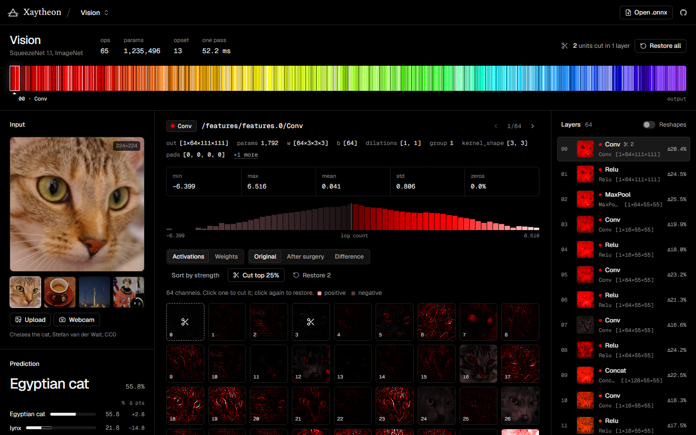
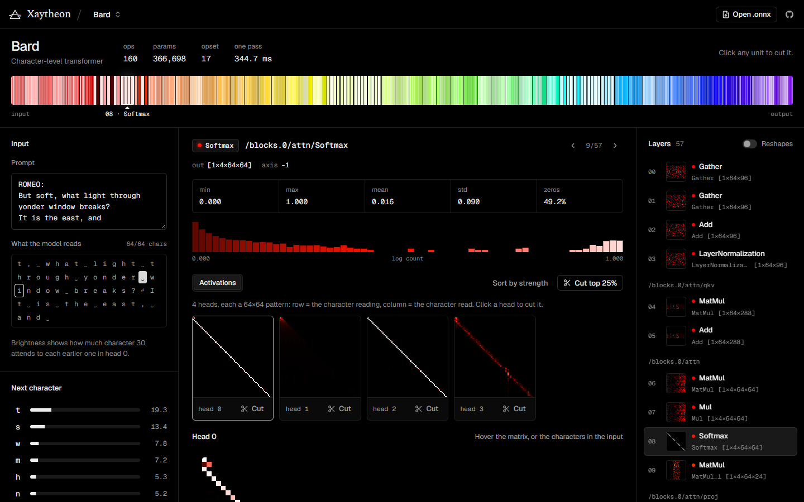
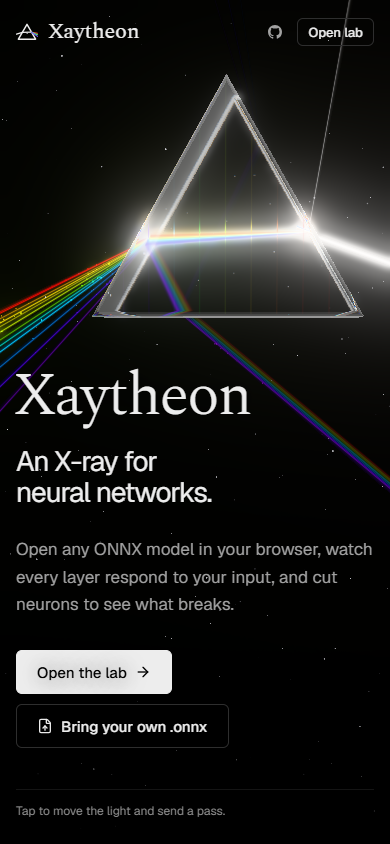
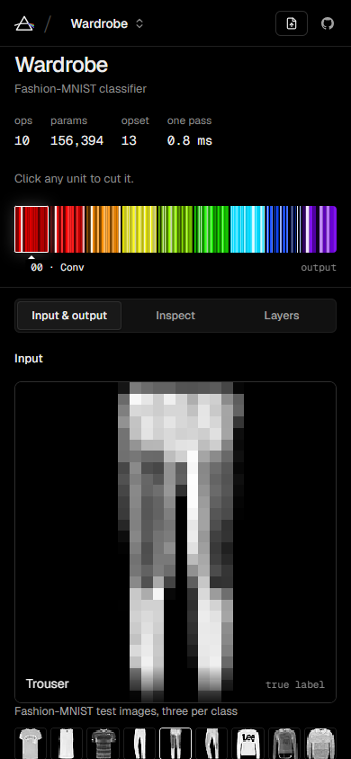
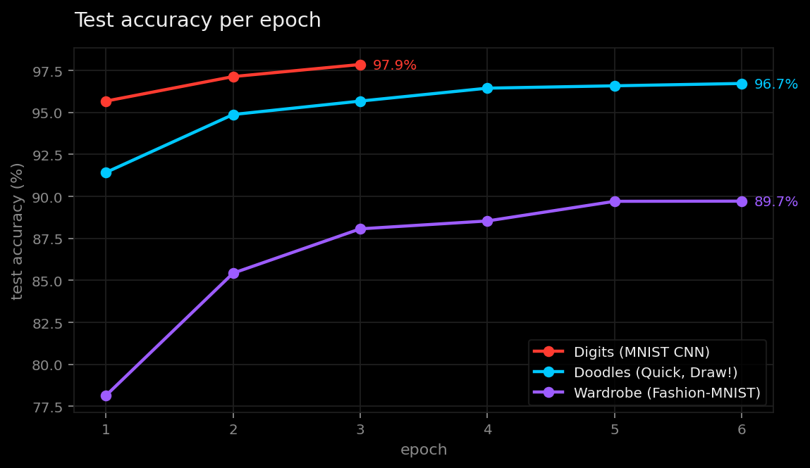
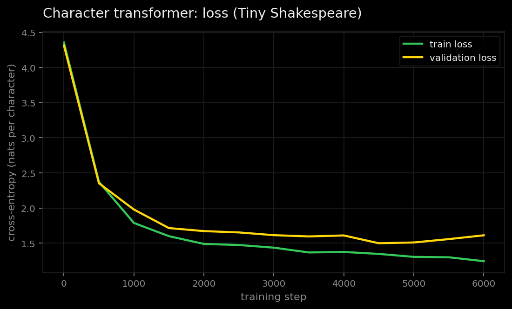
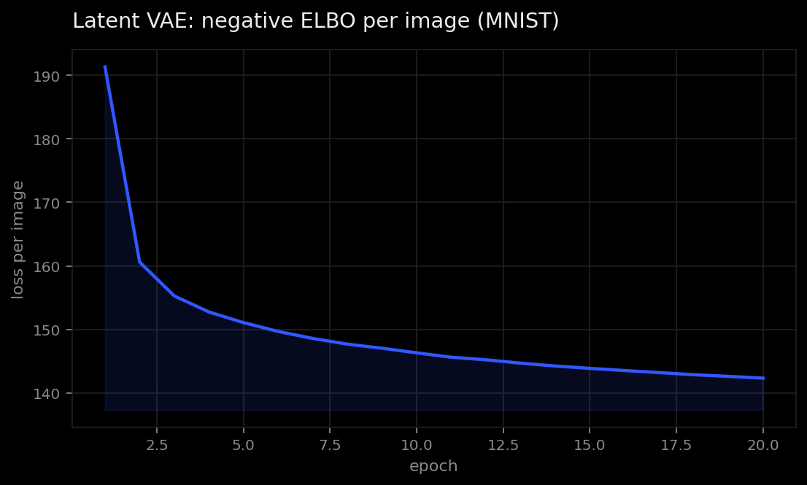
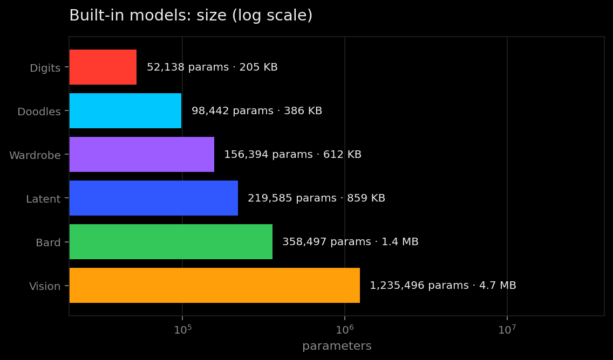

# Xaytheon

**An X-ray for neural networks.** Open an ONNX model in your browser, watch every layer respond to your input, then cut neurons, channels or attention heads and see what breaks.

Everything runs in the tab with onnxruntime-web (WebAssembly). There is no server and no upload, and nothing is stored.



## What it looks like

**Live demo.** A real MNIST CNN runs on the page. Draw a digit, click a feature map to cut it, and watch each layer below drift. The footer button cuts the four strongest channels of one layer; in the capture below that flips the answer from 7 to 3.



**The lab.** The whole model is drawn as a spectrum: one band per layer, from red at the input to violet at the output. Each thin line is a unit, brighter when it fires harder. Cut units appear as black absorption lines, so you can see the light go out downstream.



**Attention, in text.** The Bard lab shows the character transformer's attention heads. Hover a character and the matrix shows what it reads.



**On a phone.** The site and the labs work on touch screens; the lab switches between input, inspect and layers.

<p align="center">
  
  &nbsp;
  
</p>

## The site

- **Landing:** a laminated glass prism. You steer the light: it rides an arc beside the glass, follows your pointer's height on a spring, and the beam is traced through the glass with Snell's law, Cauchy dispersion and Fresnel splitting at every surface. It leaves as twelve emission lines, red for input to violet for output. The prism's nine internal layers light up where the beam crosses them, and a forward pass runs through every few seconds or when you click. A live readout shows the incidence and deviation.
- **Live demo:** a real MNIST CNN on the page. Draw a digit and click a feature map to cut it.
- **The lab:** pick one of six models, or open your own `.onnx`. Each lab has:
  - **Spectrum:** the whole model as an emission spectrum. There is one band per layer, in the layer's hue from red at the input to violet at the output. Each unit is a line whose brightness is how hard it fires. Cut units become black absorption lines, and with surgery active the bands show the cut model, so you can watch the light go out downstream.
  - **Inspector:** stats (min, max, mean, std, zeros) and a log-scale histogram for the selected layer. Views include feature maps, attention patterns, token-by-hidden heatmaps, neuron bars and the layer's weights (conv kernels or matrices). With cuts active, you can switch between the original model, the cut model and their difference.
  - **Layers:** every layer with a live thumbnail, how many units are cut, and how far surgery moved it (Δ = ‖a′ − a‖ / ‖a‖).

## The models

| Lab | Model | Input | Trained / exported by |
|---|---|---|---|
| Digits | MNIST CNN, 52K params, 97.9% test acc | draw, or real test digits | `scripts/train_mnist.py` |
| Doodles | Quick, Draw! CNN, 10 classes, 96.7% held-out acc | draw, or real sketches | `scripts/train_doodles.py` |
| Wardrobe | Fashion-MNIST CNN, 89.7% test acc | real test images | `scripts/train_fashion.py` |
| Vision | SqueezeNet 1.1 (torchvision, ImageNet, 58.2% top-1) | sample photos, upload, webcam | `scripts/export_squeezenet.py` |
| Bard | 3-layer, 12-head character transformer on Tiny Shakespeare | text, plus generation | `scripts/train_charlm.py` |
| Latent | VAE decoder with a 2-D latent, MNIST | drag a point; Tour animates a path | `scripts/train_vae.py` |

Things worth trying:
- In **Bard**, cut heads 0 and 2 of the first layer (they mostly read the previous character), then press *Write 120*. The spelling falls apart.
- In **Wardrobe**, run *Cut top 25%* on `conv2` and watch the spectrum go dark from that band onward.

## Charts

These are drawn from the real training runs, not typed in by hand. Regenerate them with `python scripts/make_charts.py`.





The transformer's validation loss bottoms out near step 4,500 and then creeps up while training loss keeps falling: a small sign of overfitting on Tiny Shakespeare. The shipped checkpoint is the final one.





## How it works

ONNX models only return their final outputs, so Xaytheon edits the model bytes before running them (`src/engine/graph.ts`). It uses its own small protobuf wire-format reader and writer (`src/engine/protobuf.ts`), so every field it doesn't touch is copied byte-for-byte.

1. **Instrument.** Every node output is appended to the graph outputs, so one `session.run` returns all of them.
2. **Cut.** For a cut tensor `T`, the producer's output is renamed `T__xay_pre`, and `Mul(T__xay_pre, mask) → T` is spliced in. The mask is a broadcastable initializer with zeros on the cut units, and every consumer downstream now reads the cut tensor.
3. **Measure.** The original and the cut model run on the same input (`src/engine/useXRay.ts`). Runs are coalesced while you draw or stream the webcam.

## Run locally

```bash
npm install
npm run dev
```

To rebuild the models (needs Python with torch, torchvision, onnx, onnxruntime, scikit-image):

```bash
cd scripts
python train_mnist.py && python export_samples.py
python train_doodles.py      # downloads part of the Quick, Draw! dataset
python train_fashion.py
python export_squeezenet.py  # downloads torchvision weights
python train_charlm.py       # ~12 min on a laptop CPU
python train_vae.py
python make_cards.py         # gallery art, rendered from real activations
python make_charts.py        # the charts above (needs matplotlib)
```

## Your own model

Export it with the weights embedded in a single file:

```python
torch.onnx.export(model, example_input, "model.onnx", opset_version=17, dynamo=False)
```

Then drop it anywhere on the site. Image-shaped inputs (`[1, 1|3, H, W]`) get a photo picker; anything else gets seeded noise you can reroll. Output logits of up to 1,000 classes are shown as class bars.

## Credits

- Quick, Draw! dataset by Google (CC BY 4.0).
- Fashion-MNIST by Zalando Research (MIT).
- MNIST by Yann LeCun, Corinna Cortes and Christopher J.C. Burges.
- SqueezeNet weights from torchvision.
- Sample photos from scikit-image's data module (CC0 or public domain).
- Tiny Shakespeare from Andrej Karpathy's char-rnn.

## License

MIT, see [LICENSE.md](LICENSE.md).
